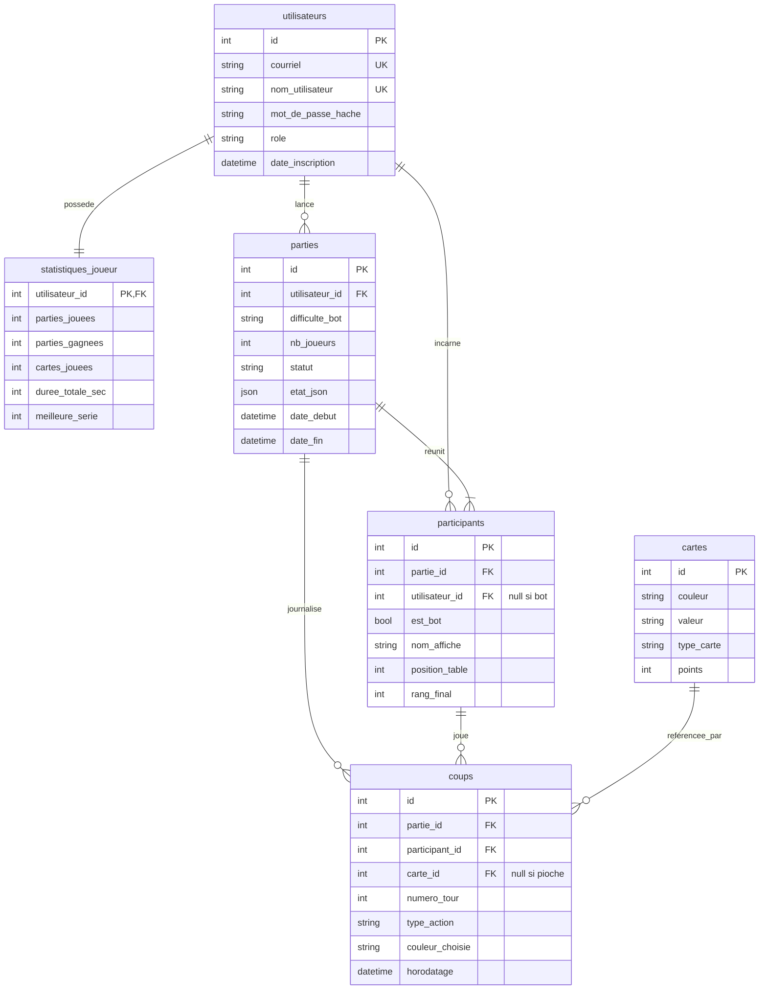
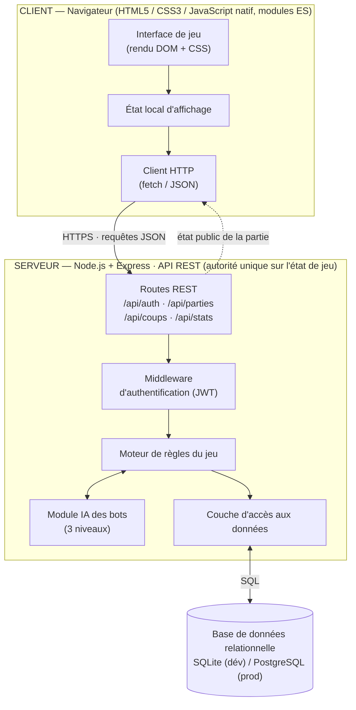

# Document de Cadrage Technique et Fonctionnel

**Projet :** Chroma — jeu de cartes en ligne contre des adversaires contrôlés par ordinateur
**Cours :** Projet intégrateur (durée : 10 semaines)
**Nom de l'étudiant :** Ivan Makarenkov
**Dépôt GitHub :** https://github.com/ivanoss/Chroma
**Date de remise :** 8 septembre 2026 (semaine 3)

---

## 1. Présentation générale du projet

### 1.1. Description synthétique

**Nom de l'application :** Chroma

**Pitch du projet :** Chroma est une application web permettant de jouer en ligne à un jeu de cartes par correspondance de couleur et de valeur, seul contre trois adversaires contrôlés par l'ordinateur. Le joueur crée un compte, lance une partie au niveau de difficulté de son choix et affronte les bots en temps réel dans son navigateur. Chaque partie est intégralement journalisée côté serveur, ce qui permet de la rejouer coup par coup, d'alimenter des statistiques personnelles et de situer le joueur dans un classement général.

> **Note :** le nom « Chroma » et l'habillage visuel sont originaux. Le projet s'inspire d'une mécanique de jeu de cartes classique sans reprendre de marque, de logo ni d'illustration appartenant à un tiers.

### 1.2. Problématique et contexte

**Problème résolu :** les jeux de cartes de ce type se jouent traditionnellement en présence physique, ce qui suppose de réunir trois ou quatre personnes disponibles au même moment. Les versions en ligne existantes imposent quant à elles d'attendre des adversaires humains, affichent de la publicité et ne conservent aucune trace exploitable des parties jouées.

**Solution apportée :** Chroma rend le jeu disponible immédiatement et en solo grâce à des adversaires artificiels de trois niveaux, tout en conservant l'historique complet de chaque partie. Le joueur peut ainsi revoir ses parties, mesurer sa progression au fil du temps et comparer ses résultats à ceux des autres joueurs inscrits.

### 1.3. Profils d'utilisateurs et rôles

| Rôle                         | Permissions                                                                                                                                                                             |
| ---------------------------- | --------------------------------------------------------------------------------------------------------------------------------------------------------------------------------------- |
| **Visiteur non authentifié** | Consulte la page d'accueil, les règles du jeu et le classement public. Ne peut ni lancer une partie ni accéder à un historique.                                                         |
| **Joueur inscrit**           | Crée et gère son compte, lance et joue des parties, abandonne ou reprend une partie en cours, consulte l'historique et le rejeu de ses parties ainsi que ses statistiques personnelles. |
| **Administrateur**           | Accède à un tableau de bord de supervision, consulte la liste des comptes et des parties, désactive un compte fautif et purge les parties abandonnées.                                  |

---

## 2. Périmètre fonctionnel

### 2.1. Fonctionnalités indispensables (MVP — Must Have)

_Ces fonctionnalités sont obligatoires pour que le projet soit considéré comme fonctionnel et évaluable à la semaine 10._

- **Authentification et gestion d'accès** — inscription, connexion et déconnexion, mots de passe hachés (bcrypt), jetons JWT, protection des routes de l'API et distinction des rôles joueur / administrateur.
- **Moteur de règles du jeu** — distribution, validation de la légalité de chaque coup, pioche, cartes d'action (inversion du sens, passage de tour, pioche imposée), cartes de changement de couleur, cumul des pénalités, déclaration « dernière carte » et détection de fin de partie. Le moteur s'exécute exclusivement sur le serveur, qui reste la seule autorité sur l'état de la partie.
- **Adversaires artificiels (bots)** — trois niveaux de difficulté : aléatoire légal, heuristique simple (priorité aux cartes d'action et à la couleur majoritaire), heuristique avancée (mémorisation des couleurs passées et des mains adverses estimées).
- **Gestion des parties (CRUD)** — création d'une partie paramétrée (nombre de bots, difficulté), reprise d'une partie interrompue, abandon, et suppression d'une partie terminée depuis l'historique.
- **Historique et rejeu** — consultation de la liste des parties passées avec leur résultat, et rejeu coup par coup d'une partie à partir du journal des actions enregistrées en base.
- **Statistiques et classement** — calcul du taux de victoire, du nombre de cartes jouées, de la durée moyenne d'une partie et de la meilleure série de victoires, puis classement général des joueurs inscrits.

### 2.2. Fonctionnalités secondaires (Nice to Have — optionnelles)

_Ces fonctionnalités ne seront codées que si le MVP est entièrement terminé et testé._

- Mode multijoueur en temps réel entre joueurs humains (WebSocket / Socket.IO) — rendu possible par l'architecture à serveur autoritaire retenue pour le MVP.
- Animations de distribution et de jeu des cartes, effets sonores, mode sombre.
- Système de succès et de badges débloqués selon les statistiques du joueur.
- Variantes de règles activables à la création d'une partie (empilement des pénalités, jeu de la carte piochée).
- Interface bilingue français / anglais.

---

## 3. Architecture et choix technologiques

| Composante           | Technologie retenue                                     | Justification technique                                                                                                                                                                                                                                                                                                                         |
| -------------------- | ------------------------------------------------------- | ----------------------------------------------------------------------------------------------------------------------------------------------------------------------------------------------------------------------------------------------------------------------------------------------------------------------------------------------- |
| **Frontend**         | JavaScript natif (ES2022), modules ES, rendu DOM        | Le cours impose les technologies web fondamentales. L'absence de framework évite une couche d'abstraction inutile pour une interface à écrans peu nombreux, et les modules ES suffisent à organiser le code en unités testables (rendu, état, appels réseau).                                                                                   |
| **Stylisation / UI** | CSS3 natif : variables, Grid, Flexbox, transitions      | Les variables CSS permettent de gérer la palette des quatre couleurs du jeu et un futur mode sombre sans dépendance externe. Grid et Flexbox suffisent à disposer la table de jeu et la main du joueur de façon adaptative.                                                                                                                     |
| **Backend & API**    | Node.js + Express, API REST (JSON)                      | Un même langage de part et d'autre réduit la charge cognitive en travail solo. Express est minimaliste et bien documenté ; une API REST suffit ici, le client n'ayant que des actions unitaires à soumettre. Le serveur héberge le moteur de règles et demeure l'autorité sur l'état, ce qui empêche toute triche par la console du navigateur. |
| **Base de données**  | SQLite en développement, PostgreSQL en production       | Le modèle est fortement relationnel (parties, participants, coups) et exige l'intégrité référentielle. SQLite ne demande aucune installation en développement ; PostgreSQL offre un déploiement gratuit et le SQL reste presque identique entre les deux.                                                                                       |
| **Tests**            | Vitest (unitaires), Supertest (API), Playwright (E2E)   | Le moteur de règles est une fonction pure de l'état et du coup joué : il se prête idéalement aux tests unitaires, y compris sur les cas limites. Supertest valide les routes et la protection par jeton, Playwright couvre le parcours complet d'une partie.                                                                                    |
| **Qualité de code**  | ESLint + Prettier, Git avec branches par fonctionnalité | Formatage et règles de lint uniformes évitent la dérive stylistique sur dix semaines ; les branches par fonctionnalité gardent la branche principale toujours fonctionnelle et démontrable.                                                                                                                                                     |

---

## 4. Modélisation technique et des données

### 4.1. Modèle relationnel de données

Le modèle est en troisième forme normale. La table `participants` résout l'association N:N entre `utilisateurs` et `parties` tout en portant les attributs propres à la participation (position à la table, rang final) ; sa clé étrangère vers `utilisateurs` est nulle lorsque le participant est un bot. La table `coups` journalise chaque action et rend le rejeu possible sans stocker d'état redondant. La table `cartes` constitue le référentiel des cartes du paquet, ce qui évite de dupliquer couleur et valeur à chaque coup joué. Enfin, `statistiques_joueur` est un agrégat mis à jour en fin de partie : ces valeurs sont calculables à partir des coups, mais leur mise en cache évite des requêtes coûteuses à chaque affichage du classement.

### 4.2. Schéma d'architecture applicative simplifié

Le client n'exécute aucune règle de jeu : il affiche l'état public de la partie et soumet des actions au serveur. À chaque requête, le moteur de règles valide la légalité du coup, applique les effets, fait jouer les bots jusqu'au prochain tour humain, persiste les coups puis retourne le nouvel état public — la main des adversaires n'est jamais transmise au navigateur.

---

## 5. Maquettes des parcours clés (Wireframes)

_Les maquettes fil de fer sont dans le document de cadrage remis en semaine 3 (PDF)._

| Écran                                    | Contenu                                                                                                                                                                                            |
| ---------------------------------------- | -------------------------------------------------------------------------------------------------------------------------------------------------------------------------------------------------- |
| **1 — Connexion / inscription**          | Formulaire unique à bascule, messages de validation, accès invité au classement public.                                                                                                            |
| **2 — Accueil du joueur**                | Bouton de nouvelle partie avec choix de la difficulté, reprise de la partie en cours, résumé des statistiques personnelles et aperçu du classement.                                                |
| **3 — Table de jeu**                     | Écran central du parcours : mains des trois bots (dos de cartes et compteur), pile de défausse, pioche, main du joueur, indicateur de couleur active et de sens de jeu, bouton « dernière carte ». |
| **4 — Historique et rejeu d'une partie** | Liste des parties passées avec filtres, et vue de rejeu coup par coup avec navigation avant / arrière.                                                                                             |

**Écrans réalisés (semaine 9)** — captures de l'application terminée :

| Écran                       | Capture                                         |
| --------------------------- | ----------------------------------------------- |
| 1 — Connexion / inscription |           |
| 2 — Accueil du joueur       |               |
| 3 — Table de jeu            |     |
| 3 — Fin de partie           |  |
| 4 — Rejeu                   |                   |
| 4 — Historique              |        |

---

## 6. Analyse des risques techniques

| Risque / défi technique                                                                                               | Impact    | Solution envisagée                                                                                                                                                                                                                                                 |
| --------------------------------------------------------------------------------------------------------------------- | --------- | ------------------------------------------------------------------------------------------------------------------------------------------------------------------------------------------------------------------------------------------------------------------ |
| Cas limites du moteur de règles (cumul des pénalités, changement de couleur, inversion à deux joueurs, fin de pioche) | **Élevé** | Écrire les règles sous forme de fonction pure et bâtir la suite de tests Vitest avant l'interface, dès la semaine 4. Chaque cas limite identifié devient un test de non-régression. La liste exhaustive des règles retenues est figée par écrit avant tout codage. |
| Synchronisation de l'état entre le client et le serveur (double soumission, rechargement de page en pleine partie)    | **Élevé** | Le serveur reste seule autorité : chaque coup est validé contre un numéro de tour attendu et rejeté s'il est périmé. Le client se réhydrate depuis l'API à chaque chargement plutôt que de conserver un état durable.                                              |
| Bots trop lents ou trop prévisibles nuisant à l'intérêt du jeu                                                        | **Moyen** | Livrer d'abord le bot aléatoire légal, qui suffit à valider le moteur, puis raffiner les heuristiques une fois le MVP stable. Un délai artificiel court entre les coups des bots rend la partie lisible sans complexité additionnelle.                             |
